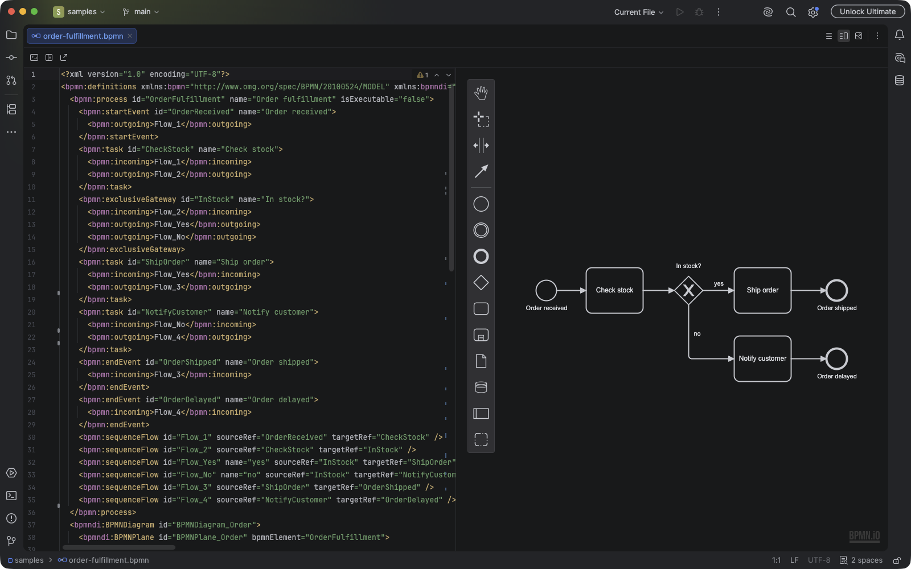
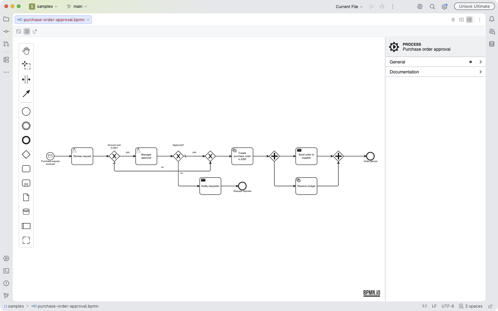

# Flawd BPMN Editor

**View and edit BPMN 2.0 process diagrams without leaving your JetBrains IDE.**

[Install](#installation) · [Features](#features) · [Usage](#usage) · [Contributing](CONTRIBUTING.md) · [Changelog](CHANGELOG.md)

Flawd BPMN Editor opens `.bpmn` files in a full graphical modeler, built on [bpmn-js](https://bpmn.io), with the XML
always one click away. The diagram and the text stay in sync both ways, and every change is a normal IDE edit you can
undo, diff and commit.

## Features

- **A real BPMN modeler:** create and connect events, tasks, gateways, pools and lanes from the palette, then rename
  them in place.
- **Diagram, Split and Text views:** switch from the editor toolbar, like the Markdown editor. Each file reopens in the
  view you left it in.
- **Two-way sync:** edit the diagram and the XML updates; edit the XML and the diagram follows. Only the changed part
  of the file is rewritten, so diffs stay small.
- **One undo history:** diagram edits are regular IDE undo steps, mixed in order with your text edits.
- **Properties panel:** set IDs, names, conditions and documentation without touching the XML.
- **Jump to the XML:** in Split view, selecting an element moves the text cursor to its definition.
- **Follows your theme:** light and dark themes are both supported, and switch with the IDE.
- **Safe with broken XML:** if the file doesn't parse, the diagram shows the error and locks until the XML is valid
  again, so it can never overwrite what you're typing.
- **Export as SVG**, and **File | New | BPMN Diagram** to start a process from a template.

### Diagram and XML side by side

### Light theme and properties panel

## Installation

**From the IDE:** open **Settings | Plugins | Marketplace**, search for **Flawd BPMN Editor**, click **Install** and
restart if prompted.

**From the web:** use **Install to IDE** on the
[Marketplace page](https://plugins.jetbrains.com/plugin/35780-flawd-bpmn-editor).

**From a file:** download `bpmn-editor-<version>-signed.zip` from the
[GitHub releases](https://github.com/srozen/flawd/releases), then choose **Settings | Plugins | ⚙ | Install Plugin
from Disk**.

### Compatibility

| Requirement | Supported |
|---|---|
| IDE versions | 2026.2 or later |
| IDEs | IntelliJ IDEA and other JetBrains IDEs that include XML support |
| Files | `.bpmn`, `.bpmn2` and `*.bpmn20.xml` (the Flowable and Activiti naming convention) |

## Usage

1. Open any BPMN file. It opens in Diagram view.
2. Drag elements from the palette on the left, and use the small menu that appears next to a selected element to
   append and connect the next step.
3. Use the buttons at the top right of the editor to switch between **Diagram**, **Split** and **Text**.
4. Use the editor toolbar to **fit the diagram** to the window, **show or hide the properties panel**, or
   **export as SVG**.
5. Undo and redo work as usual (<kbd>⌘Z</kbd> / <kbd>Ctrl+Z</kbd>), whether the last change was made in the
   diagram or in the text.

To start a new process, right-click a folder and choose **New | BPMN Diagram**.

## Known limitations

- **One-time reformatting:** the first diagram edit rewrites the file in bpmn-js's formatting (attribute order and
  indentation). Files created by other tools get a one-time formatting diff; later edits only touch what changed.
- **Vendor extensions:** Camunda, Flowable and Zeebe extension attributes are kept in the XML, but the properties panel
  doesn't show or edit them yet.
- **No schema validation:** the XML view knows the BPMN namespaces but doesn't validate against the BPMN XSDs.

Found a bug or missing a feature? [Open an issue](https://github.com/srozen/flawd/issues).

## Contributing

Contributions are welcome. [CONTRIBUTING.md](CONTRIBUTING.md) covers building and running the plugin, how the editor
works, and the project layout. [docs/RELEASING.md](docs/RELEASING.md) covers how releases are signed and published.

## License

[MIT](LICENSE) © 2026 Samuel Monroe

The diagram editor is built on [bpmn-js](https://bpmn.io) by Camunda Services GmbH, which is distributed under its own
license; that license requires the bpmn.io watermark to remain visible on the canvas. The plugin ships the licenses of
all bundled open source packages in `THIRD-PARTY-NOTICES.txt`.
