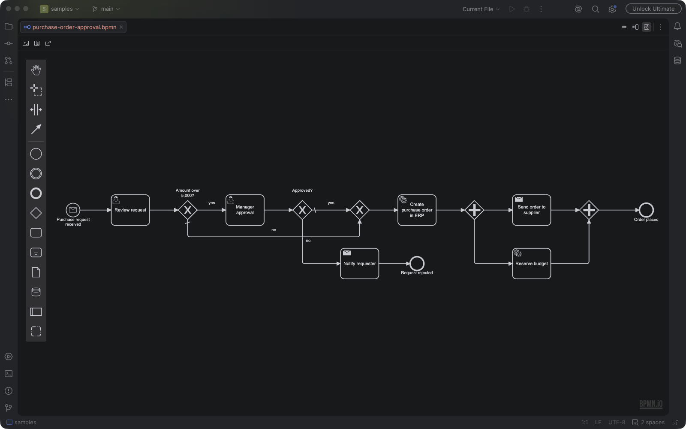

# Flawd BPMN Editor

Source: https://github.com/srozen/flawd



An IntelliJ Platform plugin for viewing and editing BPMN 2.0 diagrams (`.bpmn`, `.bpmn2`, `*.bpmn20.xml`).
The diagram is the [bpmn-js](https://bpmn.io) modeler running in the IDE's embedded Chromium (JCEF).

- **Diagram / Split / Text** views (toolbar toggle at the top right of the editor), like the Markdown editor
- **Two-way sync**: diagram edits are written into the XML document, and text edits re-render the diagram
- **Properties panel** for names, IDs, conditions, documentation and so on (toggle in the editor toolbar)
- **IDE undo/redo** covers diagram edits. Each diagram change is one undoable command, and only the changed range of the XML is replaced.
- In split view, selecting an element moves the text caret to its XML
- Follows the IDE's light/dark theme; **Export as SVG** from the editor toolbar
- **File | New | BPMN Diagram** creates a starter process

## Project layout

```
build.gradle.kts           IntelliJ Platform Gradle Plugin 2.x build; also runs the web build
web/                       bpmn-js editor page (esbuild bundles it into one self-contained index.html)
  src/main.js              modeler setup + the JS side of the IDE bridge
  src/editor.css           layout and the dark theme (overrides bpmn-io's --bio-* tokens)
src/main/kotlin/dev/flawd/bpmn/
  BpmnEditorProvider.kt    file editor provider, split editor, toolbar actions, settings
  BpmnDiagramEditor.kt     JCEF browser, document <-> diagram sync, theme, SVG export
  BpmnFiles.kt             which files are BPMN, file icon
  NewBpmnFileAction.kt     File | New | BPMN Diagram
src/main/resources/META-INF/plugin.xml
samples/order-fulfillment.bpmn
CHANGELOG.md               release notes; the current version's section becomes the Marketplace "What's New"
.github/workflows/         Build (tests + Plugin Verifier) and Release (sign, publish, GitHub release)
```

## Building and running

Requirements: JDK 25 (the JBR bundled with IntelliJ 2026.2 works) and Node.js/npm (for the web bundle).

```bash
./gradlew runIde          # start a sandbox IDE with the plugin installed
./gradlew buildPlugin     # build/distributions/bpmn-editor-<version>.zip, installable via Settings | Plugins | Install from Disk
./gradlew test
```

By default Gradle downloads IntelliJ IDEA `platformVersion` (see `gradle.properties`). To build against an
installed IDE instead, which is much faster, add this to `~/.gradle/gradle.properties`:

```properties
platformLocalPath=/Users/you/Applications/IntelliJ IDEA.app
```

If Gradle can't find `npm` (e.g. when it runs from inside the IDE without your shell's PATH), set
`npmCommand=/absolute/path/to/npm` the same way.

### Working on the web editor

`./gradlew buildWeb` writes `build/generated/web/bpmn-editor/index.html`. The page works in a normal browser too:
serve that folder and call `bpmnEditor.init({ xml })` from the console. Messages that would go to the IDE are logged
to the console instead. When it runs inside the IDE, you can open DevTools from the browser's context menu if
`ide.browser.jcef.contextMenu.devTools.enabled` is turned on in the Registry.

## Publishing to JetBrains Marketplace

### Before the first release

1. **Name and ID:** the plugin is "Flawd BPMN Editor" with ID `io.github.srozen.flawd` (`<id>` in `plugin.xml`).
   The ID can never change once published. The Kotlin package `dev.flawd.bpmn` is independent of it.
2. **Vendor details:** `pluginVendorName`, `pluginVendorEmail` and `pluginVendorUrl` in `gradle.properties` must
   match your vendor profile on plugins.jetbrains.com. They're shown publicly, and `publishPlugin` refuses to run
   without an email or URL.
3. **Signing certificate:** every release must be signed with the same key, so back it up somewhere safe
   (a password manager, for example). Never commit it. To create one:

   ```bash
   mkdir -p ~/.config/flawd-signing && cd ~/.config/flawd-signing
   openssl rand -base64 33 | tr -d '\n' > password.txt
   openssl genpkey -aes-256-cbc -algorithm RSA -pkeyopt rsa_keygen_bits:4096 -out private_encrypted.pem -pass file:password.txt
   openssl req -new -x509 -days 3650 -key private_encrypted.pem -passin file:password.txt -subj "/CN=Srozen" -out chain.crt
   ```
4. **GitHub secrets:** store the certificate for the Release workflow:

   ```bash
   cd ~/.config/flawd-signing
   gh secret set CERTIFICATE_CHAIN --repo srozen/flawd < chain.crt
   gh secret set PRIVATE_KEY --repo srozen/flawd < private_encrypted.pem
   gh secret set PRIVATE_KEY_PASSWORD --repo srozen/flawd < password.txt
   ```
5. **First release:** the Marketplace only accepts a new plugin's first version through its website. Push the
   version tag (see below) with no `PUBLISH_TOKEN` secret set. The Release workflow then signs the plugin and
   attaches `bpmn-editor-<version>-signed.zip` to a GitHub release. Upload that zip at plugins.jetbrains.com with
   **Upload plugin**, choose the MIT license, set the source code URL to this repo, and add screenshots.
   JetBrains reviews new plugins by hand before they're listed.
6. **Publishing token:** once the plugin is approved, create a token under your Marketplace profile's
   **My Tokens** and store it with `gh secret set PUBLISH_TOKEN --repo srozen/flawd`. Later releases then publish
   automatically.

### Every release

1. Move the `[Unreleased]` notes in `CHANGELOG.md` under a new version heading and set `pluginVersion` in
   `gradle.properties` to match. A pre-release version such as `0.2.0-beta.1` goes to the Marketplace `beta` channel
   and becomes a GitHub pre-release.
2. Commit, then tag and push. The tag must be `v` plus `pluginVersion`:

   ```bash
   git tag v0.2.0
   git push origin main v0.2.0
   ```

   The **Release** workflow tests and signs the plugin, publishes it to the Marketplace if `PUBLISH_TOKEN` is set,
   and creates a GitHub release with the signed zip and that version's changelog.

The **Build** workflow runs the tests on every push and pull request, plus JetBrains' Plugin Verifier against the
recommended IDE versions. To run the verifier locally against a single installed IDE, use
`./gradlew verifyPlugin -PverifyLocalIde=/path/to/IDE.app`.

To publish from your machine instead of CI, export the same four values and run `./gradlew publishPlugin`.

### Licensing

The plugin is MIT licensed (`LICENSE`, also bundled as `META-INF/LICENSE`). The web build generates
`THIRD-PARTY-NOTICES.txt` from every npm package that ends up in the bundle and ships it inside the plugin.
bpmn-js's license additionally requires the **bpmn.io watermark** on the canvas to stay fully visible and never
overlapped, so keep any new overlay below its `z-index` of 100 (see the note in `web/src/editor.css`).

## How the sync works

The XML document is the source of truth.

| Direction | Mechanism |
|---|---|
| IDE → diagram | A document listener debounces for 250 ms, then calls `bpmnEditor.importXml(xml)`. The viewport is preserved. |
| diagram → IDE | `commandStack.changed` is debounced for 120 ms, then `saveXML` runs and the result goes through `JBCefJSQuery` (`changed\n<xml>`). The IDE applies it in a `WriteCommandAction` that replaces only the differing range. |
| undo/redo | bpmn-js's undo/redo actions are rerouted to the IDE's `UndoManager`, which reverts the document; the diagram then re-imports it. |
| invalid XML | The diagram shows the parse error and is locked, so it can't overwrite your text, until the XML parses again. |

## Known limitations

- The first diagram edit re-serializes the whole file the way bpmn-js formats it (attribute order, indentation),
  so files written by other tools get a one-time formatting diff.
- Vendor extensions (Camunda, Flowable, Zeebe) round-trip as unknown XML. Their dedicated properties aren't shown
  in the panel. Adding `camunda-bpmn-moddle` or `zeebe-bpmn-moddle` plus the matching properties providers in
  `web/src/main.js` would add them.
- It needs an IDE runtime with JCEF; without JCEF only the text view is available.
